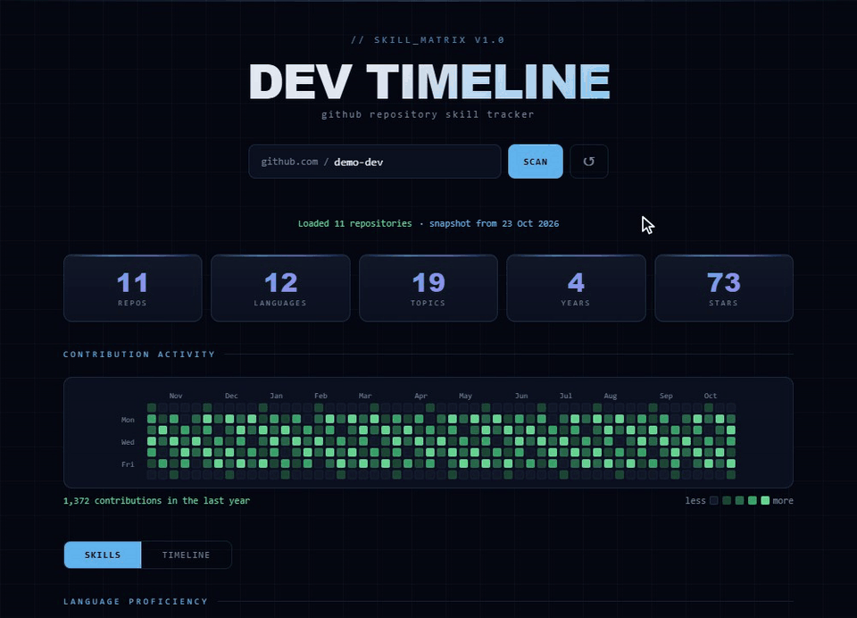
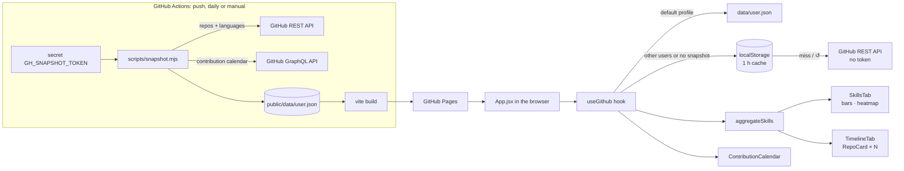
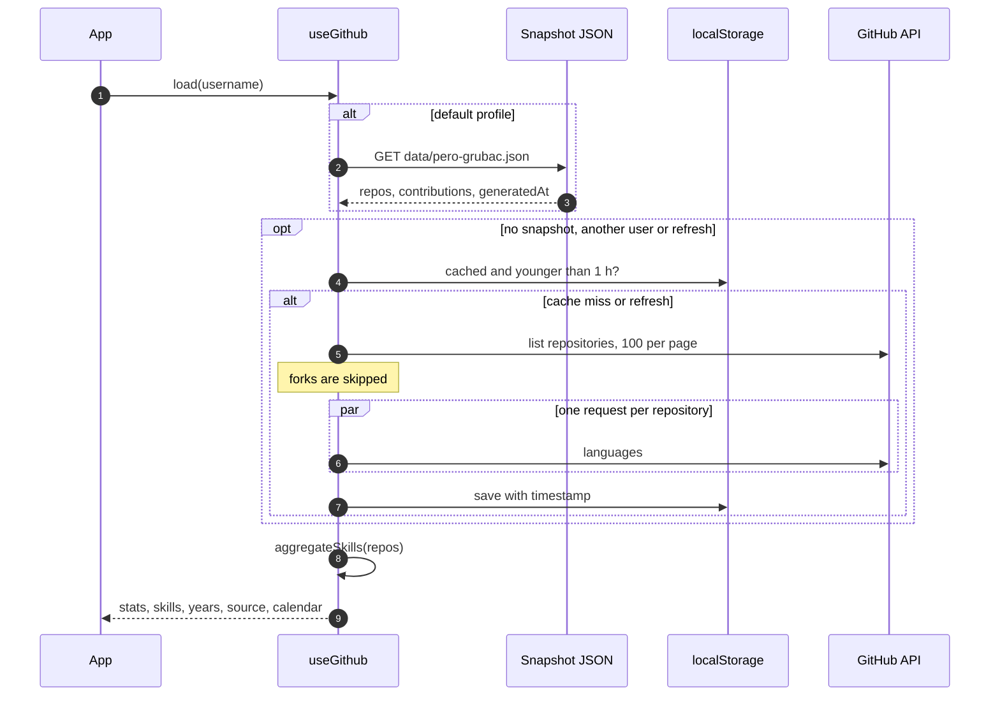

<div align="center">

# 📈 Dev Timeline

[](https://github.com/pero-grubac/dev-timeline/actions/workflows/ci.yml)
[](https://github.com/pero-grubac/dev-timeline/actions/workflows/deploy.yml)


**A skill timeline for any public GitHub profile: which languages and tools you used, when, and how much.**

[](https://pero-grubac.github.io/dev-timeline/)



</div>

---

## 📌 Project Overview

**Dev Timeline** reads a public GitHub profile through the GitHub REST API, looks at the languages and topics of every repository, and turns them into a skill map and a timeline: what you worked with, when you started, and how often you came back to it.

It is a single-page React app with no backend. The default profile is loaded from a **snapshot built at deploy time** (repositories plus the contribution calendar), so the page opens instantly and no GitHub token ever reaches the browser. Any other username is scanned live from the public API, and those results are cached in `localStorage` for an hour.

---

## ✨ Features

- ⚡ **Loads straight away**: the default profile comes from a JSON snapshot built during the deploy, with no API calls from the browser
- 🟩 **Contribution heatmap**: GitHub-style calendar of the last year (month labels, a tooltip per day, total), shown when the snapshot includes it
- 🏷️ **Data source in the status bar**: `snapshot from <date>`, `live API` or `live API (cached)`
- 🔒 **No token in the bundle**: the token is only used by the snapshot script on the CI runner
- 📊 **Skills map**: language bars, tools & frameworks bars (from repository topics) and a **language × year heatmap**
- 🗂️ **Timeline**: every repository on a vertical timeline, grouped by the year it was created, with description, tags, stars and a link
- 🔍 **Any public profile**: type a username and press **SCAN**
- 💾 **One-hour cache** in `localStorage` for live scans, with **↺** to fetch live data (bypassing both snapshot and cache)
- 🎨 **Dark terminal-style UI**: grid background, scan line, Space Mono + Syne, and colours that are lightened automatically when GitHub's own language colour would be too dark to read
- 📱 **Responsive**: compact stats, and both heatmaps scroll horizontally on phones (the calendar opens on the most recent weeks)

### 📊 What it shows

| View | Description |
|------|-------------|
| **Stats** | Repositories, languages, topics, active years and stars |
| **Contribution activity** | Contributions per day for the last year, one square per day, darker to brighter green by quarter of the busiest day (default profile, when the snapshot has it) |
| **Language bars** | How many repositories use each language |
| **Tools & frameworks** | The most used repository topics |
| **Language × year** | Which languages appeared in which year; cell intensity is usage |
| **Repository timeline** | Every non-fork repository by creation year: name, description, language, topics, stars |

---

## 🛠️ Tech Stack

| Technology | Usage |
|------------|-------|
| React 19 | UI |
| Vite 8 | Dev server and bundler |
| GitHub REST API v3 | Repositories and per-repository language bytes |
| GitHub GraphQL API | Contribution calendar (snapshot script only, needs a token) |
| Node 22 script | `scripts/snapshot.mjs`: deploy-time snapshot with plain `fetch`, no dependencies |
| `localStorage` | One-hour result cache |
| ESLint 10 | Linting (React Hooks + React Refresh rules) |
| `node:test` | Unit tests for the data, snapshot, calendar layout and colour logic |
| Playwright | End-to-end smoke tests (desktop and mobile) with the API and snapshot mocked |
| Lighthouse CI | Performance, accessibility, best-practices and SEO audit in CI |
| GitHub Actions + GitHub Pages | CI, daily snapshot refresh and deployment |

No UI libraries, CSS frameworks or state-management libraries.

---

## 📁 Project Structure

```
dev-timeline/
├── index.html
├── vite.config.js              base: '/dev-timeline/'
├── eslint.config.js
├── playwright.config.js        e2e: build + vite preview on :4321, desktop and mobile
├── lighthouserc.json
├── scripts/
│   └── snapshot.mjs            Deploy-time snapshot → public/data/<user>.json
├── public/data/                Snapshot output (git-ignored, built by the deploy)
├── src/
│   ├── main.jsx                Entry point
│   ├── App.jsx                 Header, search, tabs; loads the default profile on mount
│   ├── index.css               All styles
│   ├── hooks/
│   │   └── useGithub.js        Snapshot → cache → live API → aggregate, plus status and source
│   ├── utils/
│   │   ├── github.js           Snapshot fetch, paginated GitHub API calls (no token)
│   │   ├── snapshot.js         DEFAULT_USERNAME, repository normalisation, source label
│   │   ├── contributions.js    Calendar layout: weeks → SVG cells, month labels, levels
│   │   ├── dates.js            UTC date formatting
│   │   ├── aggregate.js        aggregateSkills(): languages, topics, years
│   │   └── colors.js           Language/topic colours, contrast fix for dark colours
│   └── components/
│       ├── StatsRow.jsx        Summary cards
│       ├── ContributionCalendar.jsx  SVG contribution heatmap
│       ├── SkillsTab.jsx       Language bars, topic bars, heatmap
│       ├── SkillBar.jsx        One bar
│       ├── LangHeatmap.jsx     Language × year table
│       ├── TimelineTab.jsx     Repositories grouped by year
│       └── RepoCard.jsx        One repository on the timeline
├── tests/                      node:test suites (aggregate, colors, snapshot, contributions)
│   └── e2e/                    Playwright smoke tests and fixtures
├── readme_assets/demo.gif
└── .github/workflows/
    ├── ci.yml                  Unit + lint + build, e2e, Lighthouse on pull requests and branches
    └── deploy.yml              Tests and e2e, then snapshot, build, deploy (also daily)
```

---

## 📦 Installation

You need [Node.js](https://nodejs.org/) 20 or newer and npm.

```bash
git clone https://github.com/pero-grubac/dev-timeline.git
cd dev-timeline
npm install
```

### Snapshot (optional)

The app works without any setup: the default profile falls back to the live API when there is no snapshot. To try the snapshot locally:

```bash
npm run snapshot                                  # unauthenticated, no heatmap
GITHUB_TOKEN=github_pat_xxxx npm run snapshot     # with the contribution heatmap
SNAPSHOT_USER=someone npm run snapshot            # another profile (the app only reads the default one)
```

It writes `public/data/<user>.json`: repositories with languages, topics, dates and stars (forks skipped), the contribution calendar when a token is set, and a `generatedAt` timestamp. The folder is git-ignored; the deploy builds it fresh. Without a token it prints a warning, works within the 60 requests/hour limit and skips the calendar, which only the GraphQL API provides.

---

## ▶️ Usage

```bash
npm run dev        # http://localhost:5173/dev-timeline/
```

1. The default profile (`pero-grubac`) loads on its own from the snapshot: the status bar shows `snapshot from <date>` and the contribution heatmap appears above the tabs.
2. Type another username after `github.com /` and press **SCAN** (or Enter). It is scanned live from the public API, without a token.
3. Switch between **SKILLS** and **TIMELINE**.
4. Live results are cached for an hour per username; **↺** fetches live data, bypassing the snapshot and the cache.

To use a different profile by default, change `DEFAULT_USERNAME` in `src/utils/snapshot.js` (the app and the snapshot script both read it).

### Scripts

| Command | Description |
|---------|-------------|
| `npm run dev` | Dev server with hot reload |
| `npm run build` | Production build to `dist/` |
| `npm run preview` | Serve the production build |
| `npm run lint` | ESLint |
| `npm test` | Unit tests (`node --test`) |
| `npm run test:e2e` | Playwright smoke tests against the production build |
| `npm run snapshot` | Write `public/data/<user>.json` (reads `GITHUB_TOKEN`, `SNAPSHOT_USER`) |

---

## 🏗️ Architecture



### How a scan works



### 🔒 Security

Earlier versions read a `VITE_GITHUB_TOKEN` at build time. Vite inlines every `VITE_*` variable into the JavaScript bundle, so anyone could copy the token from DevTools. **No token ships to the browser anymore**: the token lives only in the `GH_SNAPSHOT_TOKEN` repository secret and is used by `scripts/snapshot.mjs` on the CI runner. The browser only downloads the resulting JSON and, for other profiles, calls the public API anonymously.

If the old `VITE_GITHUB_TOKEN` secret is still set, delete it and revoke that token.

---

## 🚀 CI/CD

| Workflow | Runs on | What it does |
|----------|---------|--------------|
| `ci.yml` | Pull requests and pushes to branches other than `main` | Three jobs: **test** (lint, unit tests, build), **e2e** (Playwright on desktop and mobile, API and snapshot mocked) and **lighthouse** (Lighthouse CI on the built site under `/dev-timeline/`) |
| `deploy.yml` | Push to `main`, a manual run, or **daily at 04:17 UTC** | **test** and **e2e** first, then `npm run snapshot` with `GH_SNAPSHOT_TOKEN`, build, and deploy `dist/` to GitHub Pages |

Both workflows **skip documentation-only changes** on push: commits that only touch `*.md`, `readme_assets/`, `LICENSE`, `.gitignore` or `.vscode/` do not start a run. Newer runs on the same branch cancel older ones, and npm downloads are cached. The daily run only refreshes the data (snapshot and heatmap).

### Deployment setup (once)

1. **Settings → Pages → Build and deployment → Source**: **GitHub Actions**.
2. Create a **fine-grained personal access token** at <https://github.com/settings/personal-access-tokens>:
   - **Resource owner**: your account
   - **Expiration**: a date you will remember to renew (for example one year)
   - **Repository access**: **Public repositories (read-only)**
   - **Permissions**: none beyond the defaults (public repository data and the contribution calendar need nothing else)
3. **Settings → Secrets and variables → Actions → New repository secret**, name **`GH_SNAPSHOT_TOKEN`**, value the token.

The secret is optional. Without it the snapshot runs unauthenticated, the heatmap is left out and the deploy still succeeds. If the API refuses the snapshot (rate limit, invalid or expired token), the build stops and the previous deployment stays online.

The site is served at `https://pero-grubac.github.io/dev-timeline/`.

---

## 🧭 Design Decisions

- **No backend.** The GitHub API allows CORS, so the browser can call it directly and the app can live on GitHub Pages.
- **Snapshot at deploy time instead of a token in the browser.** A static JSON file next to the app gives the default profile instant loads, no rate limit and the contribution calendar (GraphQL needs a token), while the token stays on the CI runner. A daily scheduled deploy keeps it fresh.
- **Live fallback.** Other profiles, a missing snapshot and **↺** use the public API anonymously, so nothing breaks when the snapshot is absent (for example in local development).
- **Calendar colours from the app, not from GitHub.** The API's colours are made for a light page; the heatmap uses one green from dark to bright, with levels as quarters of the busiest day, like GitHub.
- **Languages per repository, not primary language only.** A React app with CSS and HTML counts for all three, which is closer to what was actually used. Repositories with no language data fall back to their primary language.
- **Topics as frameworks.** GitHub has no "framework" field, so repository topics stand in for tools and frameworks.
- **Cache per username for an hour** to stay inside the unauthenticated rate limit when a profile is reopened.
- **Readable colours.** GitHub's linguist colours are kept, but very dark ones (CSS, PowerShell, .NET, Flutter) are mixed towards white until they reach a minimum brightness on the dark background.

---

## ⚠️ Limitations

| Limitation | Detail |
|------------|--------|
| Public repositories only | No private access |
| Rate limit | Live scans in the browser are anonymous: 60 requests/hour per IP |
| Snapshot age | The default profile is as fresh as the last deploy (at most about a day old) |
| Heatmap | Only for the default profile, and only when the deploy has `GH_SNAPSHOT_TOKEN` |
| Topics required | Framework detection depends on repository topics being set |
| Language detection | GitHub's byte counts, not lines actually written |

---

<div align="center">

*All data comes from the public GitHub API, through the deploy-time snapshot or live. Nothing is stored on a server.*

</div>
